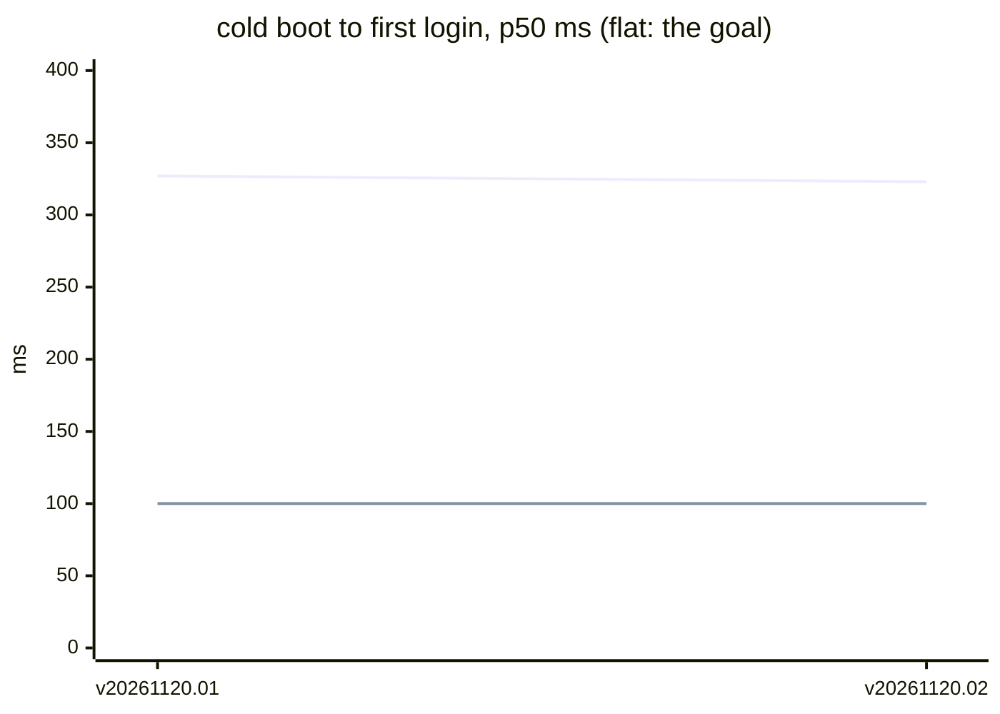
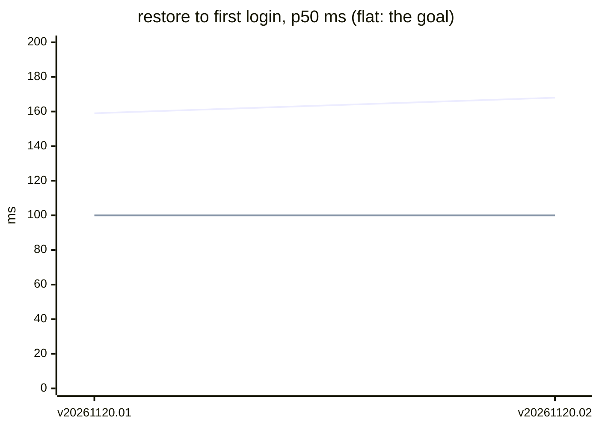

<!-- Written by `spin-machine-dev releases doc` from docs/releases/*.json: edit those, never this. -->

# Releases, measured

Each release is measured on the bench fleet once it is published (report.yml), booted by the spin-machine of its own commit; a release from before that by `spin-machine-dev releases measure`. The goal is 100 ms (AGENTS.md). Each release is measured in a run of its own, and the bench moves between runs by as much as a release does: two reports taken on different days said v20261119.02 accepted SSH 7.3% later than v20261119.01, and the two interleaved on one host said it did not (labs 44583379559, 44600043625; docs/log.md). A Δ of that size says nothing; to decide on one, measure the two together: `spin-machine-dev lab ladder --newest B --releases N`, N the releases from A to B. `spin-machine-dev releases compare A B` puts two side by side.

## The goal, release by release

First SSH login, ms p50/p95. Δ is the p50 against the row above.

| release | cold boot to first login | Δ | restore to first login | Δ | cold, QEMU started ahead | restore, QEMU started ahead |
|---|---|---|---|---|---|---|
| v20261120.01 | 327 / 337 | | 159 / 164 | | 299 / 315 | 133 / 138 |
| v20261120.02 | 323 / 329 | -3.6 | 168 / 180 | +8.6 | 295 / 309 | 135 / 140 |

v20261120.02 against the goal: cold +223 ms, restore +68 ms.

## Diagnostics

Not targets: what moves behind the goal's numbers (AGENTS.md, "The goal"). p50.

| release | save ms | state MiB | kernel to "Freeing" ms | QEMU RSS MiB |
|---|---|---|---|---|
| v20261120.01 | 155 | 156 | 62.5 | 207 |
| v20261120.02 | 158 | 155 | 62.5 | 207 |

## Where each was measured

| release | measured | host | boots of each probe | run |
|---|---|---|---|---|
| v20261120.01 | 2026-11-20 | c8id.4xlarge, nested | 20 | [44641240861](https://github.com/spin-stack/spin-machine/actions/runs/44641240861) |
| v20261120.02 | 2026-11-20 | c8id.4xlarge, nested | 20 | [44727451080](https://github.com/spin-stack/spin-machine/actions/runs/44727451080) |
