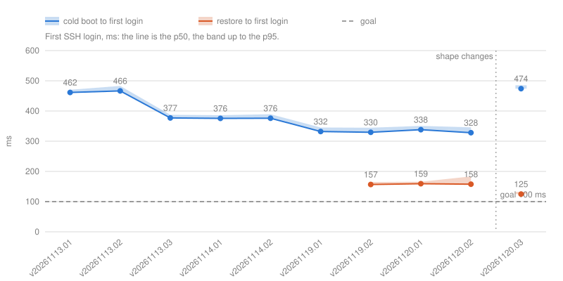

<!-- Written by `spin-machine-dev releases doc` from docs/releases/*.json: edit those, never this. -->

# Releases, measured

The bench fleet measures each release once it is published (report.yml). It boots the release interleaved with the release before it, each by the spin-machine of its own commit, in the shape spin boots a workspace in. A release from before report.yml was measured by `spin-machine-dev releases measure`. Each record says the shape it booted, and a number is read only beside one in the same shape. The goal is 100 ms (AGENTS.md). A Δ is read only between two releases booted in the same run, because the bench moves between runs by as much as a release does: v20261120.01's restore to first login was 158.9 ms p50 in one run and 167.0 in another (labs 44641240861, 44727451080). So a release's Δ is against the release measured with it, with its 95% interval. A Δ whose interval includes 0 is within noise, whatever its size. `spin-machine-dev releases compare A B` puts two side by side.

## The goal, release by release

First SSH login, ms p50/p95. Δ is the p50 against the release before it, booted interleaved with it in the same run, and its [95% interval]: within noise when the interval includes 0.

| release | cold boot to first login | Δ | restore to first login | Δ | cold, QEMU started ahead | restore, QEMU started ahead |
|---|---|---|---|---|---|---|
| v20261119.02 | 518 / 536 |  | 181 / 183 |  | 476 / 485 | 154 / 162 |
| v20261120.01 | 508 / 516 | -3.2 [-10.1, +4.6] within noise | 185 / 305 | +2.1 [-2.9, +9.6] within noise | 482 / 491 | 156 / 172 |
| v20261120.02 | 502 / 513 | +1.2 [-4.0, +15.7] within noise | 182 / 632 | +1.1 [-2.0, +6.1] within noise | 472 / 484 | 155 / 162 |
| v20261120.03 | 474 / 485 | -35.7 [-43.1, -27.6] | 125 / 132 | -46.7 [-48.2, -43.5] | 446 / 459 | 102 / 106 |
| v20261120.04 | 456 / 477 | -14.3 [-20.4, -8.2] | 108 / 111 | -13.2 [-15.1, -11.4] | 428 / 440 | 83.2 / 87.1 |

v20261120.04 against the goal: cold +356 ms, restore +8 ms.

## Diagnostics

Not targets: what moves behind the goal's numbers (AGENTS.md, "The goal"). p50.

| release | save ms | state MiB | kernel to "Freeing" ms | QEMU RSS MiB |
|---|---|---|---|---|
| v20261119.02 | 180 | 183 | 90.2 | 240 |
| v20261120.01 | 181 | 183 | 88.8 | 240 |
| v20261120.02 | 176 | 182 | 89.3 | 238 |
| v20261120.03 | 122 | 178 | 70.8 | 234 |
| v20261120.04 | 122 | 178 | 79.9 | 232 |

## Where each was measured

| release | measured | host | shape | boots of each probe | against | run |
|---|---|---|---|---|---|---|
| [v20261119.02](releases/v20261119.02.json) | 2026-11-20 | c8id.4xlarge, nested | 1 of 16 vCPUs, 128 of 8192 MiB, 4 hotplug disks, sized to 2048 MiB, spin's login | 20 | v20261119.01 | [44820465606](https://github.com/spin-stack/spin-machine/actions/runs/44820465606) |
| [v20261120.01](releases/v20261120.01.json) | 2026-11-20 | c8id.4xlarge, nested | 1 of 16 vCPUs, 128 of 8192 MiB, 4 hotplug disks, sized to 2048 MiB, spin's login | 20 | v20261119.02 | [44820465606](https://github.com/spin-stack/spin-machine/actions/runs/44820465606) |
| [v20261120.02](releases/v20261120.02.json) | 2026-11-20 | c8id.4xlarge, nested | 1 of 16 vCPUs, 128 of 8192 MiB, 4 hotplug disks, sized to 2048 MiB, spin's login | 20 | v20261120.01 | [44820465606](https://github.com/spin-stack/spin-machine/actions/runs/44820465606) |
| [v20261120.03](releases/v20261120.03.json) | 2026-11-20 | c8id.4xlarge, nested | 1 of 16 vCPUs, 128 of 8192 MiB, 4 hotplug disks, sized to 2048 MiB, spin's login | 20 | v20261120.02 | [44809542263](https://github.com/spin-stack/spin-machine/actions/runs/44809542263) |
| [v20261120.04](releases/v20261120.04.json) | 2026-11-20 | c8id.4xlarge, nested | 1 of 16 vCPUs, 128 of 8192 MiB, 4 hotplug disks, sized to 2048 MiB, spin's login | 20 | v20261120.03 | [44811347183](https://github.com/spin-stack/spin-machine/actions/runs/44811347183) |
